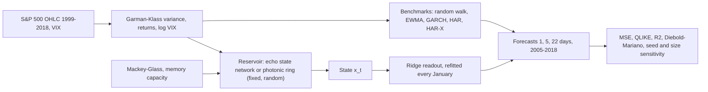
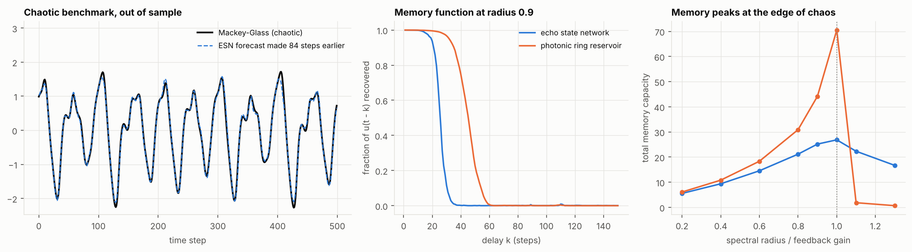
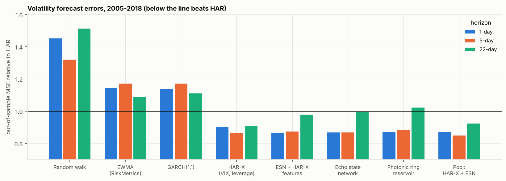
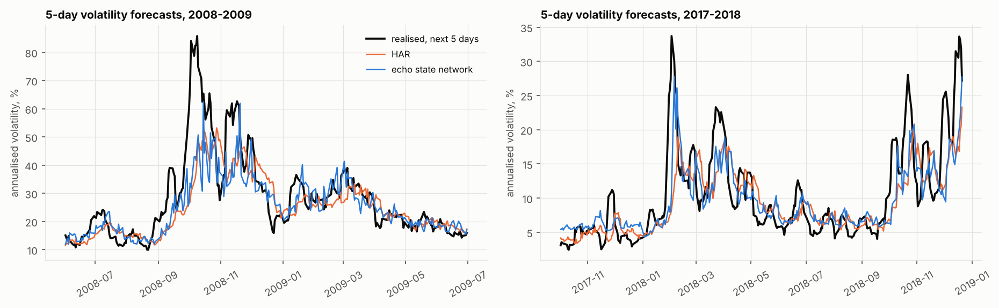
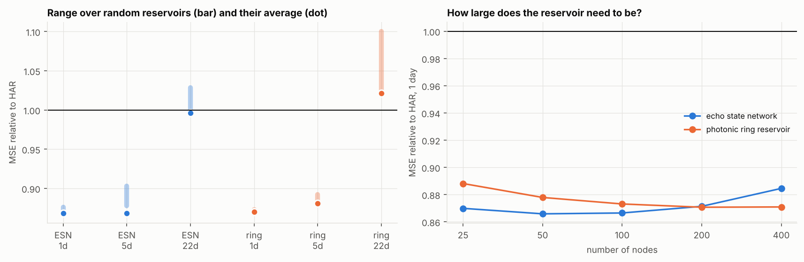

# ReservoirVol

**Reservoir computing, the machine-learning method that runs on photonic hardware, applied to volatility forecasting: an echo state network and a model of an opto-electronic delay-line reservoir, first validated on physics benchmarks, then tested out of sample for 14 years against the econometric standards (HAR, GARCH).**

  

A reservoir computer is a fixed, untrained nonlinear dynamical system driven by the input; only a linear readout of its state is fitted, by one ridge regression. Physicists like it because the reservoir can be a physical device: a laser with a fibre delay loop computes at gigahertz rates. Finance should like it for a different reason: it is a nonlinear time-series model with almost nothing to overfit, a closed-form fit, and a cost close to linear regression.

This repo asks whether that is enough to beat the models volatility desks actually use, and reports the answer by horizon, including where it loses.

1. **Build** both reservoirs from scratch in NumPy (no ML framework).
2. **Verify the physics**: chaotic time-series prediction, memory capacity, the edge of chaos.
3. **Forecast** S&P 500 volatility 1, 5 and 22 days ahead, 2005-2018, with hyperparameters fixed on pre-2005 data.
4. **Test** against random walk, EWMA, GARCH, HAR and HAR-X with Diebold-Mariano tests, and check sensitivity to the random reservoir and to its size.

```bash
pip install -e ".[dev]"
python -m reservoirvol run   # writes reports/report.md, validation.md, metrics.json, forecasts.csv, figures/
pytest                       # 12 tests
```

---

## Headline results

| | Finding |
|---|---|
| **The reservoirs behave as theory says** | On the chaotic Mackey-Glass series, 84 steps ahead, error is 0.08 (echo state network) and 0.16 (photonic ring) against 0.54 for a linear model. Memory capacity peaks at unit gain (70 of a possible 100 for the ring) and collapses beyond it: the edge of chaos. |
| **1 day ahead: reservoirs win** | MSE 13% below HAR and **3.6% below HAR-X**, the benchmark with the same inputs (Diebold-Mariano -4.0, p = 0.0001; QLIKE confirms). Out-of-sample R2 0.610 vs 0.595. GARCH and RiskMetrics are 14% worse than HAR. |
| **5 days: a tie** | Echo state network and HAR-X are indistinguishable (DM 0.2); a 50/50 pool of the two is the best model, 2% better than HAR-X (p = 0.014). |
| **22 days: reservoirs lose** | 10% worse than HAR-X (p = 0.03) and no better than plain HAR. Volatility has long memory; a small reservoir fed noisy daily data does not, and HAR is handed a monthly average. |
| **The photonic-style reservoir keeps up** | A ring of sine nodes, the model of real opto-electronic hardware, is within 1.5% of the random tanh network at 1 and 5 days. |
| **Small and stable** | 25 nodes give the full 1-day gain (ratio 0.870 vs 0.868 at 200). Ten different random reservoirs differ by less than 0.01 at 1 day; up to 0.08 at 22 days, which averaging removes. |
| **Validation** | **8 PASS, 0 FAIL**; hyperparameters chosen on 2003-2004 only; a unit test proves the walk-forward engine has no look-ahead. |

All numbers come from `python -m reservoirvol run` (seeded); full output in [`reports/report.md`](reports/report.md).

---

## Pipeline



## 1. Physics first



| Mackey-Glass, normalised RMSE | Linear AR(50) | Echo state network | Photonic ring reservoir |
|---|---|---|---|
| 1 step ahead | 0.0016 | 0.0007 | 0.0006 |
| 20 steps ahead | 0.459 | 0.0018 | 0.0062 |
| 84 steps ahead | 0.541 | 0.083 | 0.164 |

The two reservoirs:

    echo state network       x_t = (1 - a) x_{t-1} + a tanh(W x_{t-1} + W_in u_t + b)
    photonic ring reservoir  x_{i,t} = sin(alpha x_{i-1,t-1} + beta (M u_t)_i + phi)

The second is the standard discrete model of a delay-line reservoir: one Mach-Zehnder modulator (the sine), a fibre loop (the ring), a random input mask M. The ring is a nearly ideal linear memory up to gain 1 and useless above it; the random network remembers less and degrades gently.

## 2. Volatility forecasts, 2005-2018



| MSE of log variance relative to HAR | 1 day | 5 days | 22 days |
|---|---|---|---|
| Random walk | 1.45 | 1.32 | 1.51 |
| EWMA (RiskMetrics) | 1.14 | 1.17 | 1.09 |
| GARCH(1,1) | 1.14 | 1.17 | 1.11 |
| HAR | 1.00 | 1.00 | 1.00 |
| HAR-X (VIX, leverage) | 0.901 | 0.865 | **0.905** |
| Echo state network | 0.868 | 0.868 | 0.996 |
| Photonic ring reservoir | 0.870 | 0.881 | 1.022 |
| ESN + HAR-X features in the readout | **0.866** | 0.874 | 0.979 |
| Pool: HAR-X + ESN (50/50) | 0.869 | **0.848** | 0.923 |

3,522 forecast days. Target: log of the mean Garman-Klass variance over the next h days. Every readout is re-estimated each January on an expanding window; reservoir forecasts average 10 random reservoirs; the reservoir hyperparameters were chosen once, on 2003-2004. QLIKE gives the same ranking.



By period, against HAR-X: the 1-day gain holds in all three sub-periods (ratios 0.95, 0.94, 0.97 for 2005-07, 2008-09, 2010-18); the 22-day loss is concentrated in the crisis (1.27).

## 3. Does the random reservoir matter?



Not much at short horizons, and averaging a few reservoirs removes what variation there is. Reservoir size hardly matters at 1 day: the task needs a little nonlinearity, not a large state space, which is good news for small hardware reservoirs.

## What to take from it

* For next-day volatility, a reservoir is a cheap, significant improvement over the standard model with the same information.
* For monthly horizons, explicit long-memory features beat a generic dynamical system. A reservoir is no substitute for knowing the structure of the problem.
* Combining the two is the robust choice, as usual.
* The comparison is deliberately strict: HAR-X gets the same inputs, the hyperparameters never see the test period, and the weak 22-day result is in the headline table.

## Repository layout

```
reservoirvol/
├── configs/default.yaml        # horizons, grids, ensemble size, physics-check settings
├── data/raw/                   # S&P 500 OHLC 1999-2018, VIX (see data/README.md)
├── docs/methodology.md         # reservoirs, physics checks, forecasting design, reading of results, references
├── reports/                    # generated: report.md, validation.md, metrics.json, forecasts.csv, figures/
├── scripts/fetch_data.py
├── src/reservoirvol/
│   ├── reservoir.py            # echo state network, ring reservoir, ridge readout, memory capacity, Mackey-Glass
│   ├── volatility.py           # Garman-Klass data, HAR / GARCH / EWMA features, walk-forward engine, DM, QLIKE
│   ├── plotting.py
│   └── pipeline.py             # end-to-end run, report and checks
└── tests/                      # 12 tests, run in CI on every push
```

## Testing

`pytest` (12 tests): ridge equals OLS as the penalty vanishes; the echo state property (two initial conditions converge under the same input); reproducibility by seed; the ring topology step by step; memory capacity bounded by the number of nodes and collapsing past unit gain; Mackey-Glass bounded, chaotic and predictable by the reservoir; the Garman-Klass estimator recovering the variance of a simulated diffusion with far less noise than squared returns; targets built from future data only; **no look-ahead in the walk-forward engine** (perturbing targets not yet observable leaves forecasts unchanged); GARCH parameter recovery and mean-reverting term structure; Diebold-Mariano and QLIKE properties; and the full pipeline.

## Limitations

One index, range-based variance (no intraday data), sample ending in 2018, hyperparameters chosen on a short validation window, an idealised hardware model without noise or bandwidth limits, and no economic (trading or capital) evaluation of the forecast gains. See [`docs/methodology.md`](docs/methodology.md#6-limitations).

## Author

Amir Masominia. PhD in physics (Université Paris-Saclay) on excitable micropillar lasers for neuromorphic photonic computing; postdoctoral researcher working on machine-learning surrogate models, numerical simulation and automated measurement pipelines.

License: MIT.
